<h1>
  <picture>
    <source media="(prefers-color-scheme: dark)" srcset="docs/logo/wordmark-dark.png">
    
  </picture>
</h1>

A from-scratch digital audio workstation in Rust, modelled on REAPER's feature set and file
format, with a modern UI based on the "REAPER redesign" mockup.

- **REAPER-compatible.** Scythe opens and saves REAPER 7.73 `.RPP` projects losslessly: on 33
  real projects (~237k lines) a round trip changes only the header line. Projects play
  sample-identically to REAPER wherever that was measured, from pan laws and fades to ReaEQ,
  ReaComp, JSFX and resampling ([how](#how-scythe-is-verified)).
- **Built for the stage.** In-ear monitor mixes with "more me", setlists with count-in and stop
  markers, footswitches and control surfaces, and a headless server that runs as a service.
- **Remote and scriptable.** A web UI for tablets and phones, a JSON/WebSocket control API, an
  MCP server for AI agents (with mix analysis) and ReaScript in Lua, EEL2 and Python.

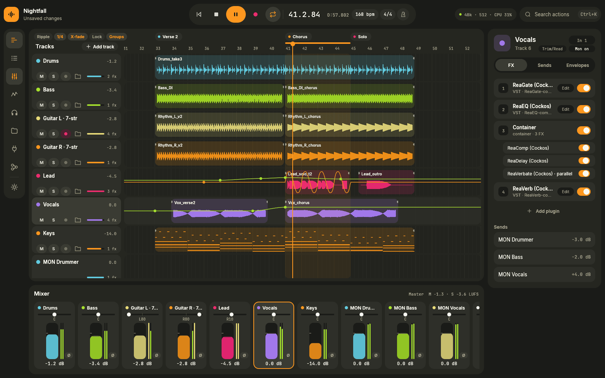

## Quick start

Scythe builds with [devbox](https://www.jetify.com/devbox), which brings Rust and the audio
libraries:

```sh
devbox run app                     # opens the generated demo song
devbox run app -- path/to/song.RPP # opens a REAPER project
devbox run test
```

Without a screen, for example as an in-ear-monitor mixer in the rack:

```sh
devbox run -- scripts/cargo.sh run -p scythe-server -- song.RPP --output-device Scarlett
devbox run app -- --headless song.RPP          # the same, from the app binary
```

The web UI and the [control API](docs/control-api.md) listen on `127.0.0.1:8770`; to reach them
from phones and tablets on the band's network, listen on the LAN with an admin token and open
`http://<machine>:8770/` in a browser:

```sh
scythe-server --control 0.0.0.0:8770 --token admin-secret --folder ~/live set.RPP
devbox run app -- --control 0.0.0.0:8770 --control-token secret song.RPP  # window + remote
```

For AI agents, Scythe is an [MCP](docs/mcp.md) server:

```sh
devbox run -- scripts/cargo.sh build --release -p scythe-mcp
claude mcp add scythe -- $PWD/target/release/scythe-mcp --url http://127.0.0.1:8770
claude mcp add --transport http scythe http://127.0.0.1:8770/mcp   # or without the binary
```

Every flag is described under [Command line](docs/features.md#command-line) and
[Remote control](docs/features.md#remote-control); [docs/live.md](docs/live.md) walks through a
whole stage setup.

## Features

A summary; [docs/features.md](docs/features.md) has the full description of each area.

### Arrange and editing

- Move, trim, split, fade, crossfade, glue, copy and paste items; razor edits, ripple editing
  (per track or all tracks), the snap grid with swing, locking and item groups.
- Takes, fixed lanes and comping by swiping, as in REAPER 7.
- Folders, multi-track selection and drag-to-reorder with REAPER's drop rules.
- The tempo map with ramps and time signatures; timebases, stretch markers, play rate, pitch
  shifting with SoundTouch and Rubber Band, dynamic split and tab-to-transient.

### Mixing and routing

- REAPER's fader law, pan laws and pan modes (balance, stereo pan with width, dual pan),
  polarity, solo in place, solo defeat and master loudness (LUFS).
- Sends post-fader, pre-FX or pre-fader, hardware outputs, multichannel tracks up to 32
  channels, sidechains and effect pin maps.
- Track groups with lead and follow per parameter, and VCA groups.

### Effects and plugins

- **Stock effect emulations** modelled on REAPER 7.73 renders: ReaEQ, ReaComp, ReaXcomp, ReaGate,
  ReaLimit, ReaDelay, ReaVerb, ReaVerbate, ReaFIR, ReaSynth, ReaSamplOmatic5000, ReaInsert and
  ReaControlMIDI, saved in REAPER's own format so REAPER opens them unchanged. Each has a
  graphical editor drawn from the emulation's own math.
- **Plugin hosting**: CLAP, LV2, VST 2 and VST 3 (instruments too), with their own editors,
  presets in REAPER's preset files and latency compensation across tracks, sends and folders.
- **JSFX** from their own source through an EEL2 interpreter that follows REAPER's compiled
  arithmetic: all 219 of REAPER's stock effects, with their `@gfx` views.
- **FX chains** with wet/dry, parallel effects, FX containers with pin routing, take FX, input
  FX, the monitoring chain, freeze, and `.RfxChain`/`.RTrackTemplate` files.
- **Neural Amp Modeler** models run natively, with a model browser, A/B snapshots and click-free
  switching; **guitar rigs** put gate, amp, cab, EQ and level in one REAPER FX container with a
  rig window, snapshots and presets; [TONE3000](docs/tone3000.md) tones can be browsed,
  previewed in the slot and kept.
- Parameter modulation (LFO, audio control signal, parameter links, MIDI), MIDI and OSC learn.

| ReaEQ | ReaComp |
|---|---|
| 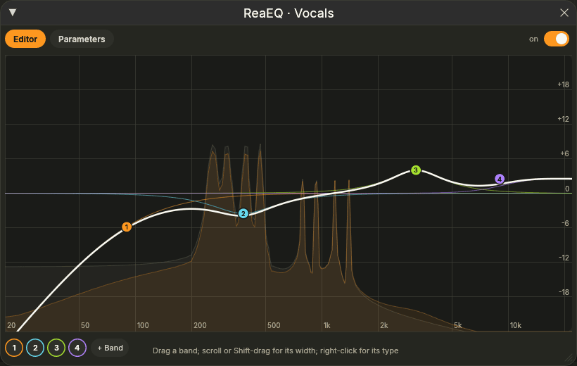 | 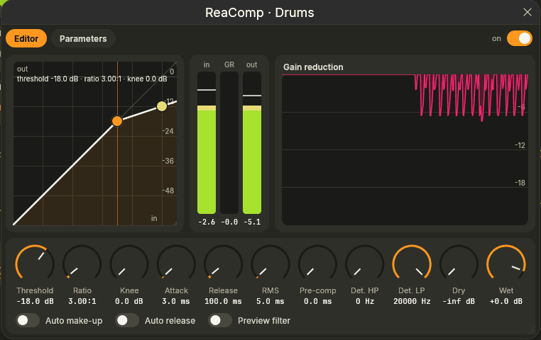 |

| Guitar rig | NAM and TONE3000 browser |
|---|---|
| 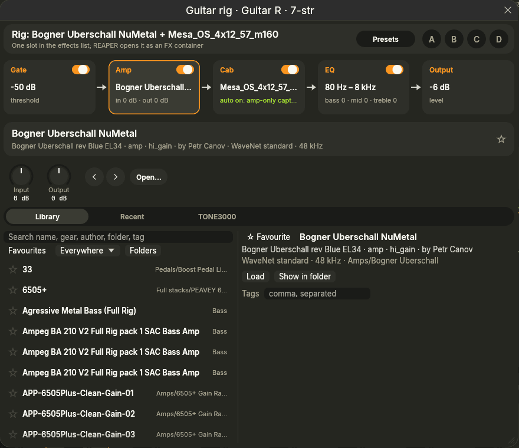 | 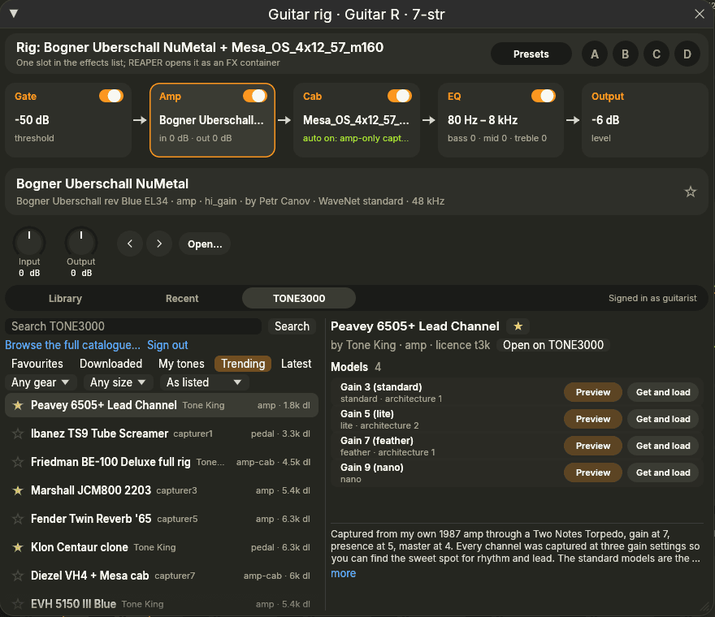 |

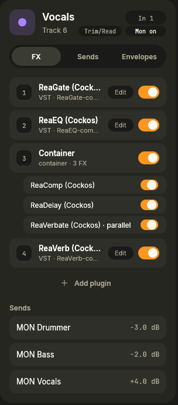

### MIDI

- A docked MIDI editor with piano roll, named notes (drum maps) and event list, controller lanes
  with REAPER 7's CC shapes, quantize with swing, humanize, transpose by scale, step input and
  groove templates; inline editors in the arrange view.
- MIDI files, MIDI recording and overdub, MIDI routing with buses, hardware MIDI outputs, MIDI
  clock, MTC and LTC (generating and chasing), and a virtual MIDI keyboard.

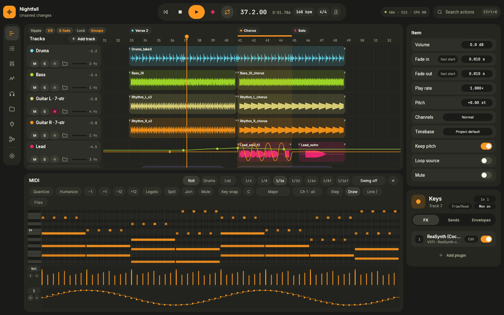

### Recording

- Recording of armed tracks with REAPER's record modes (input, output, MIDI overdub and
  replace), input monitoring through the FX chain (play a guitar through a NAM amp live),
  punch-in, auto-punch, loop recording into takes or lanes.
- Metronome, count-in and pre-roll as REAPER sets them, the click routed to any output or into
  the monitor mixes.

### Automation

- Track, send and FX parameter envelopes with every point shape, in envelope lanes on the
  arrange time axis.
- Automation items (pooled, looped, LFO shapes, baseline and amplitude) played as REAPER plays
  them; automation modes (touch, latch, write, latch preview) and the global override.

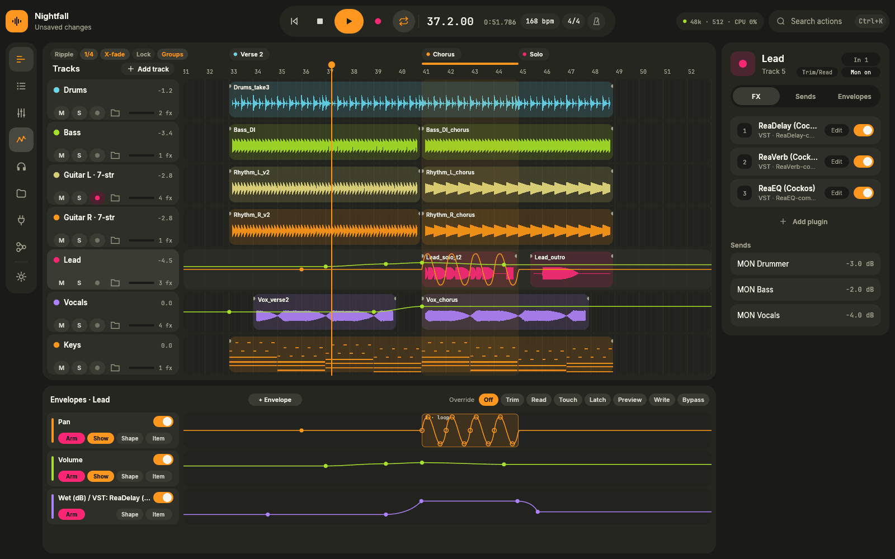

### Live and stage

- **Monitor mixes** for in-ear monitoring: a card per musician with "more me", a safety limiter
  and its own output. A mix is an ordinary REAPER track, so REAPER plays it the same.
- **Setlists** made from the project's markers, with stop markers, cues, auto-advance and a
  count-in per song, stored where REAPER keeps them.
- **Marker actions** (`!1016` stops on the marker's frame), footswitches, MIDI pedals, OSC with
  REAPER's `.ReaperOSC` files, Mackie Control, HUI and the PreSonus FaderPorts.
- A **headless server** that installs itself as a systemd service, runs with real-time priority
  and survives an unplugged audio device. See [docs/live.md](docs/live.md).

| Monitor mixes | Setlist |
|---|---|
| 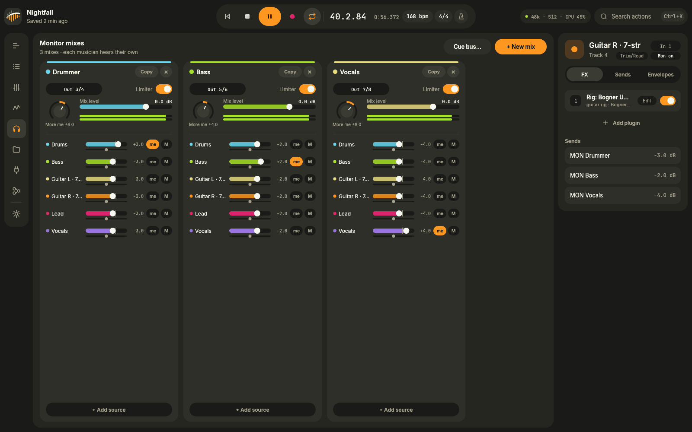 | 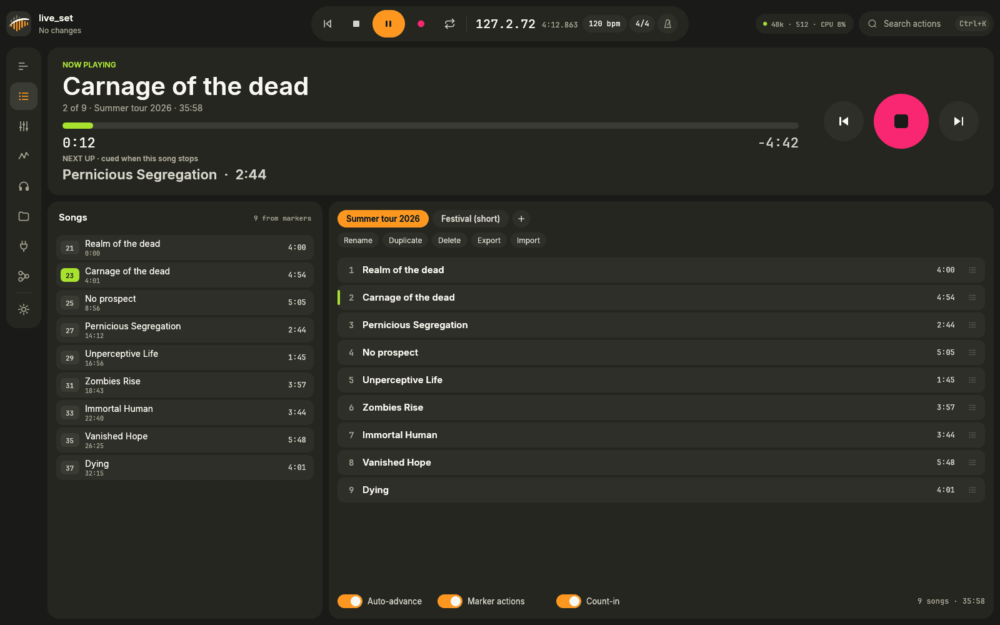 |

### Remote

- **Web UI** served by Scythe itself, no internet needed: the session editor (`/`) for a tablet
  or laptop, "more me" on a musician's phone (`/monitor`) and the drummer's setlist (`/setlist`).
  Access links with QR codes give each phone exactly the role it needs.
- **Control API**: JSON over HTTP and a WebSocket with transport, meter and project events;
  see [docs/control-api.md](docs/control-api.md).
- **MCP** for Claude Code, Claude Desktop and other agents: read and edit a running session,
  import media, find songs in backing tracks, and analyse a mix (loudness, spectrum, width,
  low end) against a reference with proposed EQ; see [docs/mcp.md](docs/mcp.md).

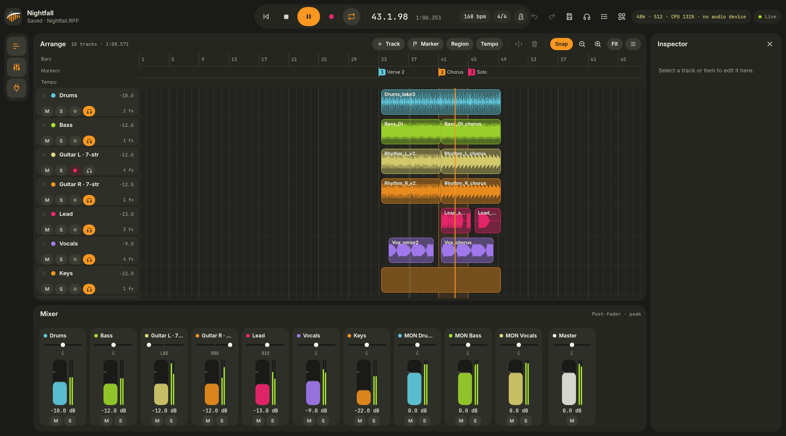

| Monitor (phone) | Setlist (tablet) |
|---|---|
| 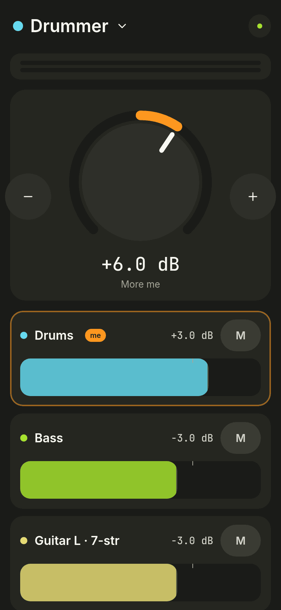 | 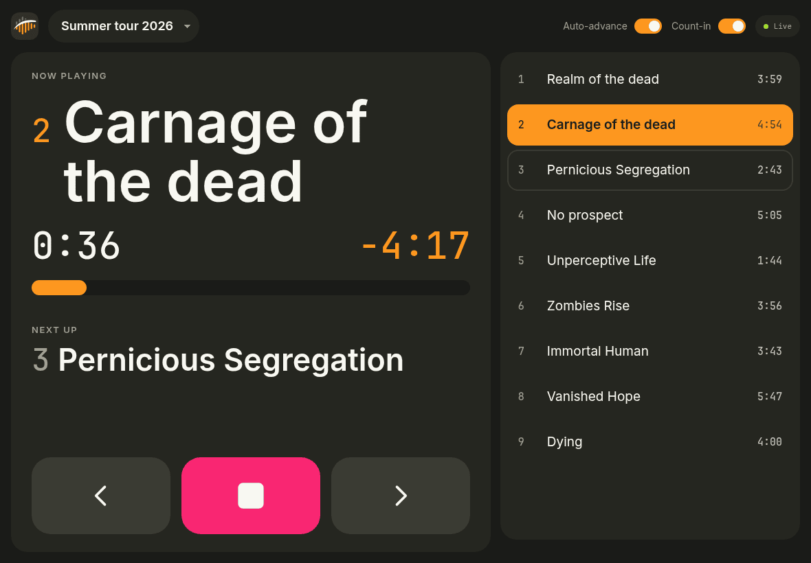 |

### Scripting

- ReaScript in Lua 5.4, EEL2 and Python: 310 `reaper.*` functions (tracks, items, takes, MIDI,
  envelopes, automation items, markers, tempo, effects, state chunks, actions), `defer` and
  `gfx` windows. A script runs as one undo step.

### Rendering and formats

- Playback of WAV, FLAC, MP3 (with REAPER's MP3 framing), Ogg, Opus, AAC, WavPack, MIDI, video
  and subprojects; every REAPER resample mode including r8brain.
- Renders with the project's own settings (bounds, stems, regions and the region matrix,
  wildcards, the render queue, normalisation, dither) to WAV, Wave64, RF64, AIFF, CAF, MP3,
  FLAC, Ogg Vorbis, Opus, WavPack, GIF, LICEcap, FFmpeg video, CD images and DDP, with metadata.

### Project and media

- Project tabs, subprojects, auto-save and backups.
- A media explorer reading REAPER's media databases, with tags, search, favourites and a
  tempo-matched preview; the project bay and "clean project directory".

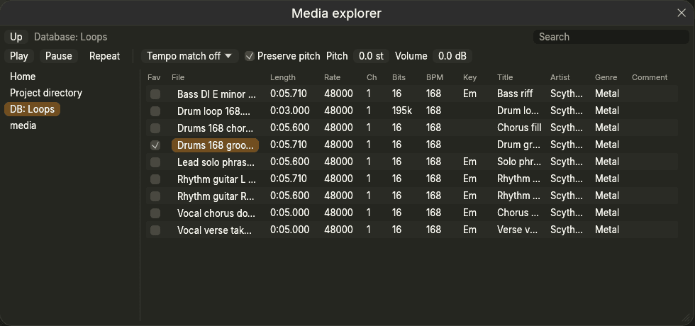

### Actions, windows and themes

- One action registry with REAPER's command ids, the action palette (Ctrl+K), keyboard
  shortcuts, custom actions, toolbars and mouse modifiers, kept in REAPER's own files
  (`reaper-kb.ini`, `reaper-menu.ini`, `reaper-mouse.ini`) so a REAPER keymap works in both.
- Window sets, remembered window positions, and themes (REAPER `.ReaperTheme` colours
  imported).

## How Scythe is verified

Scythe is checked against REAPER 7.73 itself, not against a description of it.
`crates/scythe-engine/examples/reaper_ref.rs`, `reaeq_ref.rs` and `reaverb_ref.rs` write small
projects, let REAPER render them headless and compare with Scythe's output sample by sample;
`examples/null_check.rs` re-renders any project REAPER rendered with `-renderproject` and
compares the two files. Editing, MIDI editor actions, ReaScript calls, recordings and control
surfaces are compared by running the same steps in both (Lua probes in REAPER, the control API
in Scythe). Most areas null exactly or within a stated tolerance; stretched and pitch-shifted
takes cannot (REAPER's élastique is proprietary). The full table, area by area, is in
[docs/verification.md](docs/verification.md).

## Known gaps

- Windows are drawn inside the main window, so none can move to a second screen.
- About 150 of REAPER's ~4300 main-section actions have a counterpart; there is no extension SDK,
  so SWS and other extensions do not load, and ReaScript covers part of the API.
- élastique and REAPER's own stretch modes use Scythe's phase vocoder, so stretched takes sound
  close but do not null.
- Some stock plugins (ReaPitch, ReaTune, ReaVocode, ReaSurround …) are not emulated and pass
  audio through unless REAPER's own Linux binaries are on the VST path.
- Video processors other than three stock presets are left out of renders.

Every known difference, area by area, is in [docs/limitations.md](docs/limitations.md).

## Documentation

| Document | About |
|---|---|
| [docs/features.md](docs/features.md) | every feature in detail |
| [docs/verification.md](docs/verification.md) | what was compared with REAPER and how close it is |
| [docs/limitations.md](docs/limitations.md) | what is not there yet or differs from REAPER |
| [docs/testing.md](docs/testing.md) | the unit, UI and end-to-end tests: `devbox run test` and `devbox run itest` |
| [docs/live.md](docs/live.md) | Scythe on stage: service, real-time audio, click, footswitches |
| [docs/control-api.md](docs/control-api.md) | the control API's endpoints, commands and events |
| [docs/mcp.md](docs/mcp.md) | the MCP server for AI agents |
| [docs/tone3000.md](docs/tone3000.md) | TONE3000 sign-in, browsing and the model library |

## Layout

| Crate | Contents |
|---|---|
| `scythe-core` | Project model (tracks, folders, items, takes, sends, markers, tempo map, envelopes, fades, MIDI sources), lossless `.RPP` reader/writer, pan and fader laws, undo history |
| `scythe-engine` | cpal output with a null-device fallback, lock-free transport, immutable render graph swapped via `arc-swap`, media decoding (symphonia, with REAPER's MP3 framing) and REAPER's resample modes, peaks, meters, offline WAV bounce, envelopes, metronome, preview synth, recording, FX chains (ReaEQ/ReaVerb-compatible effects, gate, compressor, convolution), CLAP, LV2, VST 2 and VST 3 hosting with editors and latency compensation, time-stretch |
| `clap-test-gain`, `lv2-test-plugins`, `vst2-test-plugin`, `vst3-test-plugin` | Minimal plugins the host tests load (one per format) |
| `scythe-session` | The live session without UI: project and undo, engine sync, media loading, recording and monitoring, metronome, automation writing, meters, save/open/auto-save; the control API (`api::Command`, events) and the pump that runs it on the session's thread |
| `scythe-server` | Control API over HTTP and WebSocket (axum) and MCP at `/mcp`, the web UI (`web/`: plain ES modules with a vendored Preact + htm), the headless runner and its config, the `scythe-server` binary |
| `scythe-surface` | Control surfaces on top of the control API: OSC with REAPER's `.ReaperOSC` pattern files, Mackie Control and extenders, HUI, FaderPort and FaderPort v2; run by the app and the server from the `csurf_<i>` preferences |
| `scythe-mcp` | MCP server for AI agents: tools generated from the control API's command types, the compact project overview, resources and prompts, tool selection, subscriptions and notifications, waiting for measuring jobs; the `scythe-mcp` stdio binary |
| `scythe-app` | egui UI around a `Session`: arrange view, mixer dock, inspector, action palette (Ctrl+K), Actions window, toolbars, plugin editor windows, ReaScript, demo generator |

`cargo run -p scythe-core --example rpp_roundtrip -- *.RPP` loads projects, writes them back
in memory and lists every line whose content changed. On 33 real REAPER projects
(~237k lines) only the header line differs.

## Clean-room approach

Scythe contains no code, binaries or data files from REAPER. Compatibility is checked from the
outside: projects go through REAPER's `.RPP` format and back, and renders are compared with
REAPER's ([docs/verification.md](docs/verification.md)). Reading and writing `.RPP` projects is an
interoperability goal.

## Licensing notes

- SoundTouch (LGPL-2.1) is loaded at run time from the system's `libSoundTouchDll`
  (devbox installs it), never vendored or linked statically; without it SoundTouch takes use the
  phase vocoder.
- Rubber Band is GPL-2.0-or-later and only used with the `rubberband` cargo
  feature, off by default (`cargo build -p scythe-app --features rubberband`), also loaded at run
  time (`librubberband`); without it Rubber Band takes use the phase vocoder.
- r8brain free (`RENDER_RESAMPLE 10`) is a Rust implementation of r8brain-free-src 6.x (MIT,
  Aleksey Vaneev); marker actions follow the SWS extension's rules, read from its source (MIT).
